<p align="center">
  
</p>

<p align="center">
  <a href="https://github.com/kxngHADES/NetRunner/actions/workflows/ci.yml"></a>
  <a href="https://github.com/kxngHADES/NetRunner/releases"></a>
  
  
</p>

<p align="center">
  <a href="#install">Install</a> &nbsp;|&nbsp;
  <a href="#quick-start">Quick start</a> &nbsp;|&nbsp;
  <a href="#flags">Flags</a> &nbsp;|&nbsp;
  <a href="#reading-the-results">Results</a> &nbsp;|&nbsp;
  <a href="#roadmap">Roadmap</a> &nbsp;|&nbsp;
  <a href="#contributing">Contributing</a>
</p>

NetRunner is a small command-line tool that answers one question: **what is listening on this machine or network?**
Point it at a host you own, and it checks which TCP ports are open, guesses what is running on them, and hands you a clean report. No admin rights, no setup, no dependencies. One binary.

<p align="center">
  
</p>

> **Scan only what you own or have permission to test.**
> NetRunner is a diagnostics and inventory tool, not an exploitation framework. It makes plain TCP connections and nothing sneakier.

---

## Why you might like it

<table>
  <tr>
    <td width="64"></td>
    <td><b>Fast, but polite.</b> A bounded worker pool scans hundreds of ports at once without exhausting your sockets.</td>
  </tr>
  <tr>
    <td></td>
    <td><b>Ctrl+C actually works.</b> Stop mid-scan and keep what was found. The report is clearly marked incomplete, never passed off as a full run.</td>
  </tr>
  <tr>
    <td></td>
    <td><b>Honest about uncertainty.</b> A timeout is reported as "filtered or unknown", because silence does not prove a firewall.</td>
  </tr>
  <tr>
    <td></td>
    <td><b>Names the usual suspects.</b> Port 22 shows as ssh, 6379 as redis, and so on. Treated as a hint, never as proof.</td>
  </tr>
  <tr>
    <td></td>
    <td><b>Script-friendly.</b> Versioned JSON reports, clean stdout, and documented exit codes.</td>
  </tr>
  <tr>
    <td></td>
    <td><b>Nice to watch.</b> A live progress bar on interactive terminals, and quiet, readable output when piped.</td>
  </tr>
</table>

---

## Install

Pick whichever suits you. Afterwards, just type `netrunner`.

<details open>
<summary><b>Linux and macOS</b></summary>

Downloads the latest release and verifies its checksum:

```sh
curl -fsSL https://raw.githubusercontent.com/kxngHADES/NetRunner/main/scripts/install.sh | sh
```

</details>

<details open>
<summary><b>Windows (PowerShell)</b></summary>

```powershell
irm https://raw.githubusercontent.com/kxngHADES/NetRunner/main/scripts/install.ps1 | iex
```

</details>

<details>
<summary><b>With Go 1.25 or newer</b></summary>

Installs into `$(go env GOPATH)/bin`, which needs to be on your `PATH`:

```sh
go install github.com/kxngHADES/NetRunner/cmd/netrunner@latest
```

</details>

<details>
<summary><b>From source</b></summary>

```sh
git clone https://github.com/kxngHADES/NetRunner
cd NetRunner
make build        # produces bin/netrunner
```

</details>

You can also grab a ready-made binary from the [Releases page](https://github.com/kxngHADES/NetRunner/releases).
Check that it worked with `netrunner version`.

---

## Quick start

```sh
# Look at your own machine (a safe first run)
netrunner scan --target 127.0.0.1 --ports 1-1024

# Check a few specific ports on a device you own
netrunner scan --target 192.168.1.10 --ports 22,80,443,8080

# Use a named profile instead of remembering port numbers
netrunner scan --target 192.168.1.10 --ports web

# Save a machine-readable report
netrunner scan --target 192.168.1.10 --format json --output results.json
```

Not sure where to start? `netrunner --help` and `netrunner scan --help` both include examples.

### Flags

| Flag | What it does | Default |
|---|---|---|
| `--target` | IPv4 address or hostname. Separate several with commas. | required |
| `--ports` | `22,80`, `1-1024`, `22,8000-8100`, or a profile (`common`, `web`) | `common` |
| `--workers` | How many connections run at once (1 to 1000) | `100` |
| `--timeout` | Per-attempt TCP timeout, such as `800ms` or `2s` | `1s` |
| `--format` | `table` or `json` | `table` |
| `--output` | Write the report to a file instead of the screen | stdout |
| `--show-closed` | Include closed and filtered ports in the table | off |
| `--no-color` | Turn off colors | auto |
| `--quiet` | Hide the progress bar | off |

Progress goes to stderr and only appears on a real terminal, so `--format json` on stdout is always clean JSON you can pipe anywhere.

---

## Reading the results

Every port lands in one of three states:

| State | What it means | Take it as |
|---|---|---|
| `open` | The connection succeeded. | Something is listening. |
| `closed` | The connection was refused outright. | The host answered; nothing is on that port. |
| `filtered_or_unknown` | It timed out, or failed in an unclear way. | Could be a firewall, packet loss, or a sleeping host. Not proof of anything. |

### Exit codes

| Code | Meaning |
|---|---|
| `0` | Scan completed |
| `1` | Unexpected internal error |
| `2` | Invalid arguments or configuration |
| `3` | Scan could not complete (for example, a hostname would not resolve) |
| `130` | You pressed Ctrl+C. The report is still written, marked `"status": "incomplete"`. |

### JSON report

Reports carry `schema_version: 1`, so tools built on them will not break silently later.

```text
schema_version  scan_id  tool  status  started_at  completed_at  duration_ms
targets  settings  summary  hosts[ ip, hostname, reachable, ports[ ... ] ]
```

Successful connections include `latency_ms`. Every report states its own target and settings, so you can always tell what was scanned.

---

## Roadmap

NetRunner is built in phases. Each one is useful on its own.

| Phase | Goal | Status |
|---|---|---|
| 1. Core scanner | TCP port scanning, worker pool, JSON export | **Done** |
| 2. Discovery | Find live hosts on a subnet (`netrunner discover --subnet ...`) | Planned |
| 3. Live dashboard | Rich terminal view with workers, hosts, and totals | Planned |
| 4. Intelligence | Scan history, change detection, light banner checks | Planned |

## Limitations

- TCP connect checks only. No ICMP, ARP, UDP, or stealth scanning.
- Service names come from port numbers, so a web server on port 9999 will not be labelled as one.
- IPv4 only for now.

---

## Contributing

Pull requests are welcome.

```sh
make test     # run the tests
make race     # run them with the race detector
make vet      # static checks
```

Commits follow [Conventional Commits](https://www.conventionalcommits.org/) (`feat:`, `fix:`, `docs:` and so on). Pull requests are squash-merged, so the **PR title** is what counts, and CI checks it for you.

Releases are automatic. After each merge to `main`, release-please opens a release PR that bumps the version and updates [CHANGELOG.md](CHANGELOG.md). Merging it creates the `vX.Y.Z` tag and GitHub release, and GoReleaser attaches binaries for Linux, macOS, and Windows (amd64 and arm64).

<p align="center"><sub>Built with Go, standard library only. Scan responsibly.</sub></p>
